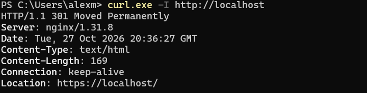
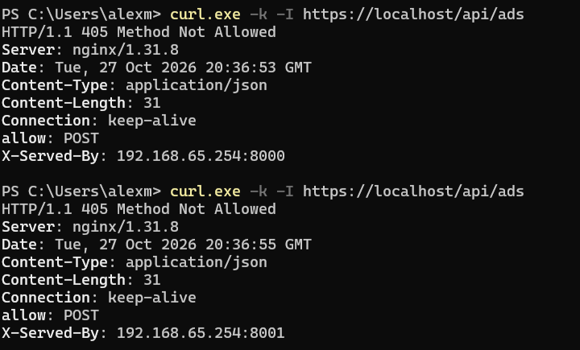
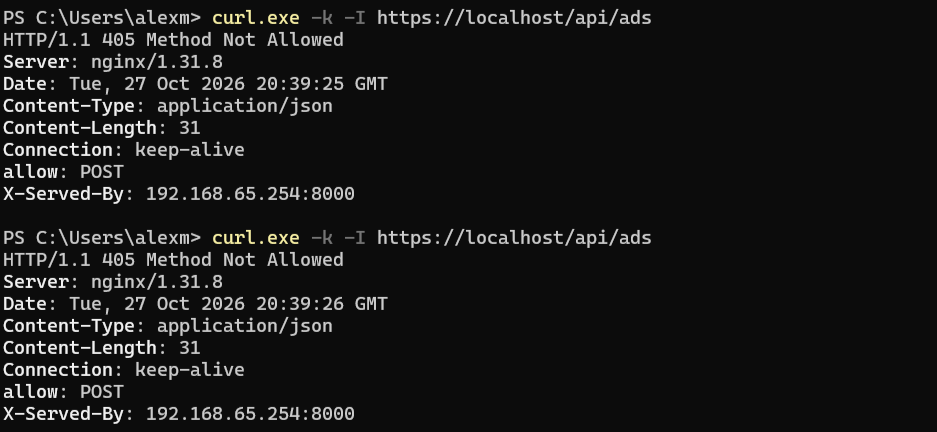
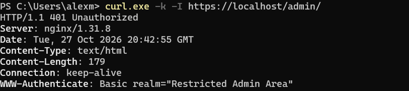
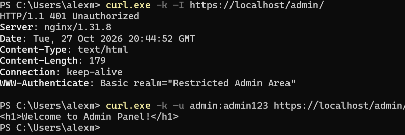
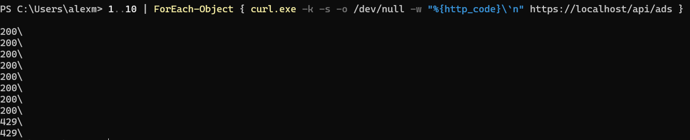
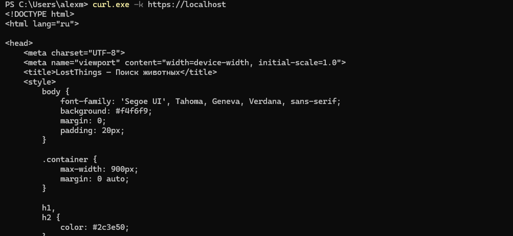
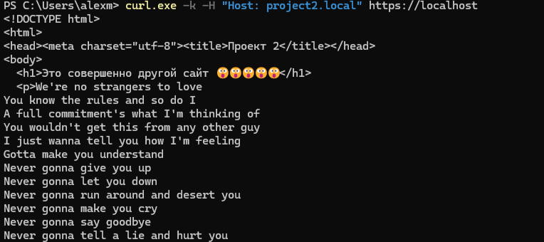
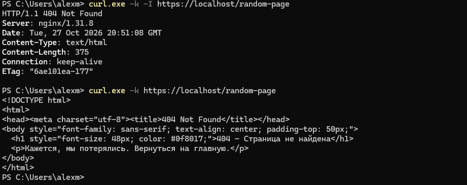
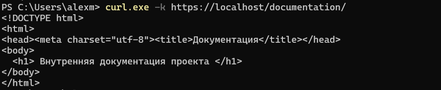

# Отчет по лабораторным работам

---

## Лабораторная работа 0

- Ссылка на репозиторий: https://github.com/SaNco-M/lostthings

В репозитории подробно описано, как запустить проект локально. К сожалению, почти все пришлось писать руками, а работает всё пока через костыль, так как полноценная регистрация пользователя через API пока не реализована.

К удивлению могу сказать, что всё работает


---

## Лабораторная работа 1: Nginx

---

### Шаг номер 0. Архитектурная подготовка

Начнем с того, что я решил не захламлять бэкенд еще больше и вынести всю работу с проксированием в отдельную инфраструктуру Nginx.

Для этого я подготовил папочку с папочками и еще чуть-чуть файликов внутри:

- В папке certs/ лежат ключи и сертификаты HTTPS;
- В папке html/ лежат файлы сайтов и страниц ошибок;
- Файл .htpasswd - хранилище логинов и зашифрованных хэшей паролей;
- Ну и, естественно, наш главный конфигурационный файл - nginx.conf.

---

### Шаг номер 1. Создание HTML-файлов

#### 1. Кастомная 404 (nginx/html/404.html)

Вместо унылой стандартной белой страницы Nginx покажем свою:

```html
<!DOCTYPE html>
<html>
<head>
  <meta charset="utf-8">
  <title>404 Not Found</title>
</head>
<body style="font-family: sans-serif; text-align: center; padding-top: 50px;">
  <h1 style="font-size: 48px; color: #0f8017;">404 - Страница не найдена</h1>
  <p>Кажется, мы потерялись. Вернуться на главную.</p>
</body>
</html>
```

#### 2. Папка для проверки alias (nginx/html/docs/index.html)

```html
<!DOCTYPE html>
<html>
<head>
  <meta charset="utf-8">
  <title>Документация</title>
</head>
<body>
  <h1>Внутренняя документация проекта</h1>
</body>
</html>
```

#### 3. Второй сайт для проверки виртуальных хостов (nginx/html/vhost2/index.html)

```html
<!DOCTYPE html>
<html>
<head>
  <meta charset="utf-8">
  <title>Проект 2</title>
</head>
<body>
  <h1>Это совершенно другой сайт 😮😮😮😮😮</h1>
</body>
</html>
```

---

### Шаг номер 2. Генерация SSL-сертификата и .htpasswd

Дальше у нас на очереди генерация SSL-сертификата и .htpasswd.

Так как сижу я на Windows и скачивать сторонние программы мне лень, я создал временный контейнер Docker для генерации самоподписанного SSL/TLS-сертификата nginx.crt и приватного ключа nginx.key, необходимых для настройки HTTPS в Nginx. Сертификат сразу делаем с современным расширением SAN (Subject Alternative Name), чтобы браузеры не ругались на устаревший CN.

(ИИ помогла):

```powershell
docker run --rm -v "${PWD}/nginx/certs:/certs" alpine/openssl req -x509 -nodes -days 365 -newkey rsa:2048 -keyout /certs/nginx.key -out /certs/nginx.crt -subj "/CN=lostthings.local" -addext "subjectAltName=DNS:lostthings.local,DNS:localhost,IP:127.0.0.1"
```

Также создаем пользователя admin с простым паролем admin123:

```powershell
docker run --rm httpd:alpine htpasswd -nb admin admin123 | Out-File -Encoding ascii ./nginx/.htpasswd
```

---

### Шаг номер 3. Главный конфигурационный файл nginx.conf

Теперь мы переходим к самому отважному шагу, к трюку на крыше небоскреба. Наша цель - настроить так называемый файл nginx.conf.

В нем нам необходимо оформить редирект с HTTP на HTTPS, балансировщик двух серверов, раздачу статики (стиля), ограничение частоты запросов, псевдоним пути alias, защиту админки паролем и второй сайт на одном сервере.

А вот и сам файл nginx/nginx.conf:

```nginx
events {
    worker_connections 1024;
}
http {
    include       mime.types;
    default_type  application/octet-stream;
    sendfile      on;
    # 1. Защита от флуда: максимум 5 запросов в секунду на один IP
    limit_req_zone $binary_remote_addr zone=api_limit:10m rate=5r/s;
    limit_req_status 429;
    # 2. Балансировщик нагрузки между двумя копиями бэкенда на портах 8000 и 8001
    upstream backend_servers {
        server host.docker.internal:8000 max_fails=1 fail_timeout=5s;
        server host.docker.internal:8001 max_fails=1 fail_timeout=5s;
    }
    # ========================================================
    # ХОСТ 1: Основной проект (lostthings.local)
    # ========================================================
    # HTTP (Порт 80) — Принудительное перенаправление (301 Redirect) на HTTPS
    server {
        listen 80;
        server_name lostthings.local localhost;
        return 301 https://$host$request_uri;
    }
    # HTTPS (Порт 443) - Защищенный сервер
    server {
        listen 443 ssl;
        server_name lostthings.local localhost;
        # Пути к SSL-сертификатам
        ssl_certificate     /etc/nginx/certs/nginx.crt;
        ssl_certificate_key /etc/nginx/certs/nginx.key;
        ssl_protocols       TLSv1.2 TLSv1.3;
        # Собственная страница 404
        error_page 404 /404.html;
        # 3. Раздача стиля и фронтенда напрямую Nginx
        location / {
            root /usr/share/nginx/html;
            index index.html;
            try_files $uri $uri/ =404;
        }
        # Отдача файла кастомной 404
        location = /404.html {
            root /usr/share/nginx/html;
            internal;
        }
        # 4. Использование директивы alias (в крысу подменяем пути)
        location /documentation/ {
            alias /usr/share/nginx/html/docs/;
            index index.html;
        }
        # 5. Раздел /admin, закрытый паролем из .htpasswd
        location /admin/ {
            auth_basic "Restricted Admin Area";
            auth_basic_user_file /etc/nginx/.htpasswd;
            root /usr/share/nginx/html;
            index index.html;
        }
        # 6. Проксирование API на бэкенд с балансировкой и рейтлимитом
        location /api/ {
            # Применяем ограничение скорости
            limit_req zone=api_limit burst=5 nodelay;
            proxy_pass http://backend_servers;
            proxy_set_header Host $host;
            proxy_set_header X-Real-IP $remote_addr;
            proxy_set_header X-Forwarded-For $proxy_add_x_forwarded_for;
            proxy_set_header X-Forwarded-Proto $scheme;
            # Добавляем адрес ответившего бэкенда для наглядной проверки балансировки
            add_header X-Served-By $upstream_addr always;
        }
    }
    # ========================================================
    # ХОСТ 2: Второй проект (Виртуальный хост project2.local)
    # ========================================================
    server {
        listen 443 ssl;
        server_name project2.local;
        ssl_certificate     /etc/nginx/certs/nginx.crt;
        ssl_certificate_key /etc/nginx/certs/nginx.key;
        location / {
            root /usr/share/nginx/html/vhost2;
            index index.html;
        }
    }
}
```

---

### Шажочек с номерочком 4. Подключение к Docker Compose

Кроме этого всего, нам необходимо, чтобы всё это работало в изолированном контейнере, слушало порты 80 и 443, а также видело наши конфигурационные файлы. Из этого следует, что мы добавляем в docker-compose.yml вот такие буковки:

```yaml
  nginx:
    image: nginx:alpine
    container_name: lostthings-nginx
    ports:
      - "80:80"
      - "443:443"
    volumes:
      - ./nginx/nginx.conf:/etc/nginx/nginx.conf:ro
      - ./nginx/certs:/etc/nginx/certs:ro
      - ./nginx/html:/usr/share/nginx/html:ro
      - ./nginx/.htpasswd:/etc/nginx/.htpasswd:ro
    extra_hosts:
      - "host.docker.internal:host-gateway"
    depends_on:
      - postgresSQL
```

---

### Шаг номер 5. Запуск серверов

Маленький шаг для человечества, огромный шаг для меня. Запускаем БД, запускаем 2 копии бэка и запускаем Nginx:

1.  Запуск базы данных и Nginx: Из корня проекта:

```powershell
    docker compose up -d postgresSQL nginx
```

2.  Запуск Бэкенда №1 (на порту 8000):

```powershell
    cd backend
    uvicorn app.main:app --port 8000
```

3.  Запуск Бэкенда №2 (на порту 8001):

```powershell
    cd backend
    uvicorn app.main:app --port 8001
```

---

### Шаг номер 6. Проверочка

Для проверки я curl.exe спамил

#### 1. Редирект 301 с HTTP на HTTPS

Запрос по незащищенному протоколу HTTP возвращает редирект 301:

```powershell
curl.exe -I http://localhost
```



- **Вывод:** HTTP/1.1 301 Moved Permanentlyъ

#### 2. Балансировка между инстансами

Делаем несколько запросов к /api/ads и смотрим заголовок X-Served-By:

```powershell
curl.exe -k -I https://localhost/api/ads
curl.exe -k -I https://localhost/api/ads
```



- **Вывод:** В первом запросе ответил host.docker.internal:8000, во втором - host.docker.internal:8001. Запросы чередуются по очереди.

#### 3. Отказоустойчивость

Останавливаем процесс бэкенда на порту 8001 и повторяем запрос:

```powershell
curl.exe -k -I https://localhost/api/ads
```


- **Вывод:** Сервис возвращает 405 method not allowed, так быть ваще не должно, но как я понял это потому что -I отправляет запрос методом HEAD, а у меня на адресе /api/ads разрешен только POST. Но для проверки отказоустойчивости все хорошо

#### 4. Защита раздела /admin через Basic Auth

**Без авторизации:**

```powershell
curl.exe -k -I https://localhost/admin/
```



Вывод: HTTP/1.1 401 Unauthorized.

**С валидными учетными данными (admin:admin123):**

```powershell
curl.exe -k -u admin:admin123 https://localhost/admin/
```



Вывод: HTTP/1.1 200 OK, тело ответа: `<h1>Welcome to Admin Panel!</h1>`.

#### 5. Ограничение частоты запросов (Rate Limiting)

Флудим 10 запросами подряд:

```powershell
1..10 | ForEach-Object { curl.exe -k -s -o /dev/null -w "%{http_code}\`n" https://localhost/api/ads }
```



- **Вывод:** Первые запросы возвращают 200, после превышения лимита Nginx отбивает лишние запросы ошибкой 429 Too Many Requests.

#### 6. Виртуальные хосты

- Основной сайт: `curl.exe -k https://localhost`



- Второй виртуальный хост: `curl.exe -k -H "Host: project2.local" https://localhost` -> возвращает `<h1>Это совершенно другой сайт 😮😮😮😮😮</h1>`.



#### 7. Кастомная 404 и директива alias

- Запрос несуществующей страницы `curl.exe -k https://localhost/ne-sushestvuet` -> возвращает нашу зеленую страницу 404 - Страница не найдена.



- Проверка директивы alias `curl.exe -k https://localhost/documentation/` -> отдает файл из отдельной внутренней папки `docs/`.



---

## Задание со звёздочкой: Исследование уязвимостей конфигураций Nginx

Для начала я выбрал сайт, это будет сайт моей бывшей школы, я не особо любил ее, а поэтому устроем тест. https://gymnasium406.ru/. Тут я узнаю все возможную инфу, чтобы попробовать зайти в закрытую дверь.

### Шаг номер one Проверка

**Команда:**
```powershell
curl.exe -sS -D - -o NUL https://gymnasium406.ru
```

**Полученный результат:**
```http
HTTP/1.1 200 OK
Server: nginx/1.12.2
Date: Wed, 28 Oct 2026 13:23:51 GMT
Content-Type: text/html; charset=utf-8
Transfer-Encoding: chunked
Connection: keep-alive
X-Content-Type-Options: nosniff
X-Powered-By: PHP/5.4.16
Expires: Sun, 19 Nov 1978 05:00:00 GMT
Cache-Control: no-cache, must-revalidate, post-check=0, pre-check=0
X-Content-Type-Options: nosniff
Content-Language: ru
X-Generator: Drupal 7 (http://drupal.org)
Link: <https://gymnasium406.ru/>; rel="canonical",<https://gymnasium406.ru/>; rel="shortlink"
Strict-Transport-Security: max-age=31536000;
```

**Результат:** сервер показывает стэк и его версии: Nginx 1.12.2, PHP 5.4.16 и Drupal 7.

**Вывод:** Это нам может помочь, но уже придется погуглить(закинуть в нейронку)

## 2. Проверка доступности служебных файлов

**Команда:**
```powershell
foreach ($p in @("/CHANGELOG.txt", "/README.txt", "/INSTALL.txt")) {
    curl.exe -sS -o NUL -w "$p : HTTP %{http_code}`n" "https://gymnasium406.ru$p"
}
```

**Полученный результат:**
```text
/CHANGELOG.txt : HTTP 200
/README.txt : HTTP 200
/INSTALL.txt : HTTP 200
```

**Вывод:** все три файла доступны без авторизации. Такие файлы могут раскрывать сведения о CMS, её версии и процессе установки. Содержимое файлов я проверять не стал. (Потом решил проверить, ну там ничего нет такого вроде бы)

## 3. Проверка административных скриптов

**Команда:**
```powershell
foreach ($p in @("/admin/", "/update.php", "/install.php")) {
    curl.exe -sS -o NUL -w "$p : HTTP %{http_code}`n" "https://gymnasium406.ru$p"
}
```

**Полученный результат:**
```text
/admin/ : HTTP 403
/update.php : HTTP 200
/install.php : HTTP 200
```

Для дополнительной проверки содержимого были выполнены запросы:

```powershell
curl.exe -sS -L -D .\nginx-lab\update-headers.txt `
    -o .\nginx-lab\update.html `
    -w "HTTP %{http_code}`n" `
    https://gymnasium406.ru/update.php

curl.exe -sS -L -D .\nginx-lab\install-headers.txt `
    -o .\nginx-lab\install.html `
    -w "HTTP %{http_code}`n" `
    https://gymnasium406.ru/install.php
```

**Полученные результаты:**

Файл `update.html`:
```text
Привет, если Вы - администратор, Вы знаете, что теперь делать.
```

Файл `install.html`:
```text
Спасибо, уже установлено.
```

**Вывод:** `/admin/` возвращает `403 Forbidden`, то есть доступ запрещён. Скрипт `update.php` возвращает текстовое сообщение для администратора, а `install.php` сообщает, что установка уже выполнена. Но к сожалению это пока нам не дает факт взлома.

## Общий итог

В ходе проверки получил вот такое:

1. Обнаружил версии
2. Доступность файлов `CHANGELOG.txt`, `README.txt` и `INSTALL.txt`.
3. Проверены административные URL: `/admin/` возвращает `403`, а `/update.php` и `/install.php` возвращают `200` с текстовыми сообщениями.

**Заключение:** выявлены потенциальные риски, связанные с раскрытием технической информации и доступностью служебных файлов. Надо бы проверить и сопоставить версии с уязвимостями, но этим для лабораторной я заниматься уже не буду. Взлом не получился😭😭😭