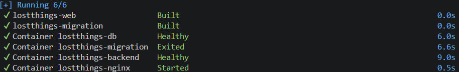
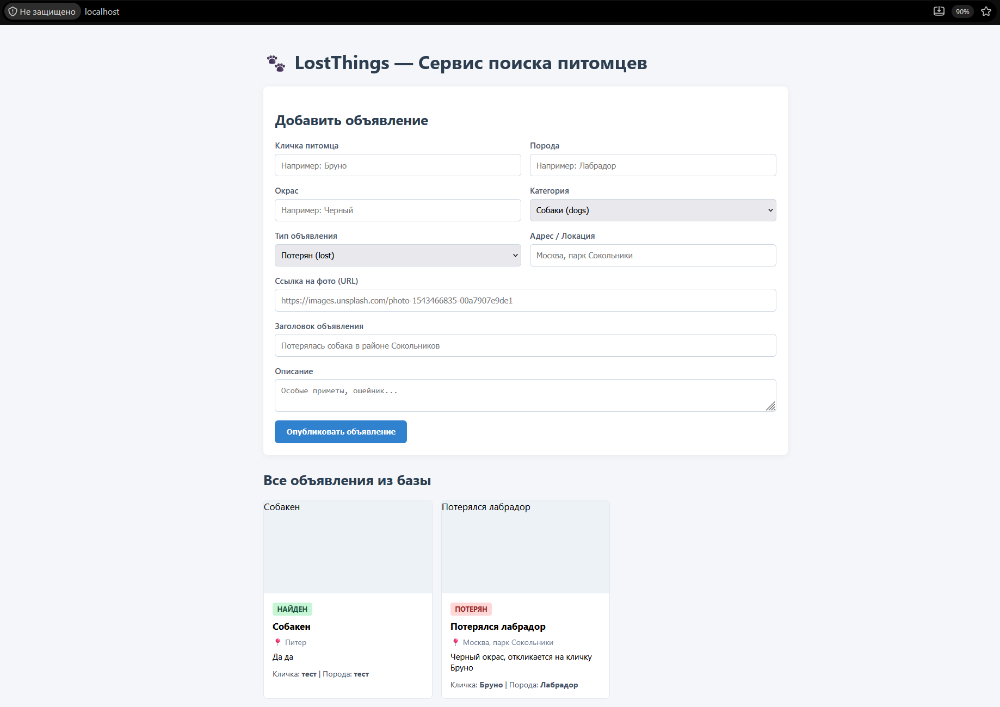
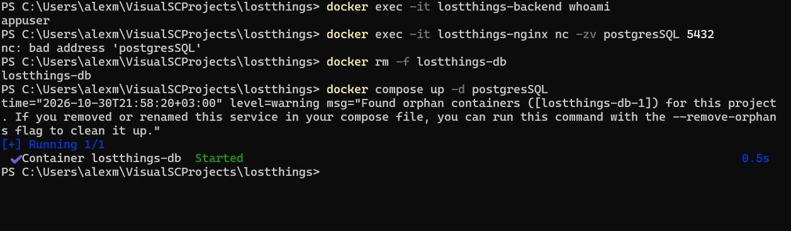
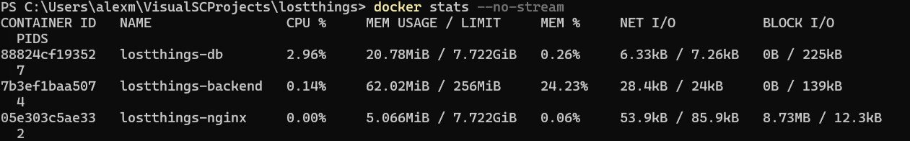
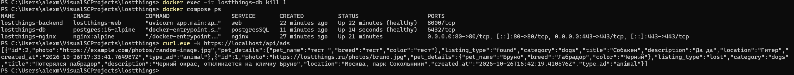

# Отчёт по лабораторным работам

---

## Лабораторная работа 2

### Шаг 1

Ну начнем с bad practices, естественно выберем образ, который наиболее тяжелый и нестабильный, то есть:

```dockerfile

FROM python:latest

```

Запустим от root

```dockerfile

WORKDIR /

```

После этого мы скопируем полностью проект со всеми ненужными файлами:

```dockerfile

COPY . /app

```

Дальше выберем нашу директорию:

```dockerfile

WORKDIR /app

```

А дальше установим зависимости без оптимизации кэша:

```dockerfile

RUN pip install -r requirements.txt

```

Ну и запустим

```dockerfile

CMD python main.py

```

Весь файл:

```dockerfile

FROM python:latest

WORKDIR /

COPY . /app

WORKDIR /app

RUN pip install -r requirements.txt

CMD python main.py

```

Дальше перейдем к хорошим практикам, я уже писал dockerfile для этого так сказать приложения, но его можно улучшить добавив HEALTHCHECK и пару других вещей, а также дополнительный эндпоинт в виде /health

Поэтому начнем с эндпоинта, добавим в main:

```python

@app.get("/health", status_code=200)

async def health_check():

    return {"status": "ok"}

```

Нужно это, чтобы понимать, работает ли приложение или контейнер запущен, но приложение сломалось, без него Docker может посчитать что с контейнером все ок, даже если внутри все не ок.

Дальше мы берем мой исходный файл:

```dockerfile

FROM python:3.12-slim

WORKDIR /app

LABEL authors="alexm"

LABEL app="lostthings"

COPY requirements.txt .

RUN pip install --no-cache-dir -r requirements.txt

COPY . .

RUN groupadd -r appgroup && \\

    useradd -r -g appgroup appuser && \\

    chown -R appuser:appgroup /app

USER appuser

EXPOSE 8000

CMD ["uvicorn", "app.main:app", "--host", "0.0.0.0", "--port", "8000"]

```

Тут и версия Python стабильная и лёгкая, и запуск приложения не от root, и кэш мы не копируем, также порты указываем и указываем команду запуска. Но это не всё, дальше нужен HEALTHCHECK.

1. Дальше зафиксировал еще более стабильную версию, теперь обновления не могут подтянуться.

```dockerfile

FROM python:3.12-slim

```

Стало:

```dockerfile

FROM python:3.12.8-slim-bookworm

```

2. Добавил многоэтапную сборку (multi-stage build), у меня был один образ для установки зависимостей и запуска приложения.

```dockerfile

FROM python:3.12-slim

WORKDIR /app

COPY requirements.txt .

RUN pip install --no-cache-dir -r requirements.txt

COPY . .

```

Стало:

```dockerfile

FROM python:3.12.8-slim-bookworm AS builder

WORKDIR /build

COPY requirements.txt .

RUN pip install --no-cache-dir --prefix=/install -r requirements.txt

FROM python:3.12.8-slim-bookworm

WORKDIR /app

COPY --from=builder /install /usr/local

COPY . .

```

Теперь зависимости устанавливаются на этапе builder, а в итоговый образ копируются только установленные пакеты. Это позволяет не переносить в финальный образ лишние файлы

3. Упростил настройку прав доступа

Было:

```dockerfile

RUN groupadd -r appgroup && \\

    useradd -r -g appgroup appuser && \\

    chown -R appuser:appgroup /app

USER appuser

```

Стало:

```dockerfile

RUN groupadd --system appgroup && \\

    useradd --system --gid appgroup appuser

COPY --chown=appuser:appgroup . .

USER appuser

```

В исходном варианте рекурсивно менялись права на все файлы в /app командой chown -R. Теперь владелец назначается непосредственно при копировании файлов.

При этом обе версии запускают приложение от непривилегированного пользователя, то есть исходный Dockerfile уже был безопаснее работающего от root.

4. Добавил проверку работоспособности приложения

В Dockerfile отсутствовал HEALTHCHECK.

Стало:

```dockerfile

HEALTHCHECK --interval=30s --timeout=5s --start-period=10s --retries=3 \\

  CMD python -c "import urllib.request; urllib.request.urlopen('http\://127.0.0.1:8000/health', timeout=3)" || exit 1

```

Теперь Docker периодически проверяет доступность HTTP-эндпоинта /health. Если проверка несколько раз подряд не проходит, контейнер получает статус unhealthy.

Вот финальный вариант:

```dockerfile

\# Этап установки зависимостей

FROM python:3.12-slim-bookworm AS builder

WORKDIR /build

COPY requirements.txt .

RUN pip install --no-cache-dir --prefix=/install -r requirements.txt

\# Финальный образ

FROM python:3.12-slim-slim-bookworm

LABEL authors="alexm" \\

      app="lostthings"

ENV PYTHONDONTWRITEBYTECODE=1 \\

    PYTHONUNBUFFERED=1

WORKDIR /app

RUN groupadd --system appgroup && \\

    useradd --system --gid appgroup appuser

COPY --from=builder /install /usr/local

COPY --chown=appuser:appgroup . .

USER appuser

HEALTHCHECK --interval=30s --timeout=5s --start-period=10s --retries=3 \\

    CMD python -c "import urllib.request; urllib.request.urlopen('http\://127.0.0.1:8000/health', timeout=3)" || exit 1

EXPOSE 8000

CMD ["uvicorn", "app.main:app", "--host", "0.0.0.0", "--port", "8000"]

```


### Шаг 2

Последнее, что нужно сделать это docker-compose и поднять приложение. 

Я написал сам docker-compose, там же лежит задание со звёздочкой.

Также у меня в GitHub есть значения по умолчанию для БД в environment, но на сервер я заливал уже без них, секреты все спрятаны, а те что видны это значения по умолчанию для теста локально(почему я .env не использовал? я не знаю.).

```yaml
services:

**  # ==============================================================================**

**  # 1. БАЗА ДАННЫХ (PostgreSQL 15)**

**  # ==============================================================================**

  postgresSQL:

    image: postgres:15-alpine       # Зафиксированная легковесная версия

    container_name: lostthings-db

    environment:

      POSTGRES_USER: ${POSTGRES_USER:-alex}

      # если пароль не передан через .env/секреты, compose остановится

      POSTGRES_PASSWORD: ${POSTGRES_PASSWORD:?POSTGRES_PASSWORD is required}

      POSTGRES_DB: ${POSTGRES_DB:-lostthings_db}

    volumes:

      - postgres_data:/var/lib/postgresql/data

    networks:

      # Сетевая изоляцияt

      - backend-net

    healthcheck:

      # проверка готовности СУБД

      test: ["CMD-SHELL", "pg_isready -U $$POSTGRES_USER -d $$POSTGRES_DB"]

      interval: 5s

      timeout: 5s

      retries: 5

      start_period: 10s

    restart: always                # (со звёздочкой): авторестарт при сбоях

**  # ==============================================================================**

**  # 2. ОДНОРАЗОВЫЙ СЕРВИС МИГРАЦИЙ (Alembic)**

**  # ==============================================================================**

  migration:

    build:

      context: ./backend           # папка с кодом бэкенда

      dockerfile: Dockerfile

    container_name: lostthings-migration

    environment: 

      DATABASE_URL: ${DATABASE_URL:?DATABASE_URL is required}

    command: alembic upgrade head  # Применение миграций

    networks:

      - backend-net                # Доступ только к БД

    depends_on:

      postgresSQL:

        # ждём, пока БД не перейдет в статус healthy

        condition: service_healthy

    restart: "no"                  # Одноразовая задача

**  # ==============================================================================**

**  # 3. БЭКЕНД ПРИЛОЖЕНИЯ (FastAPI)**

**  # ==============================================================================**

  web:

    build:

      context: ./backend

      dockerfile: Dockerfile

    container_name: lostthings-backend

    expose:

      # Порт 8000 открыт только внутри Docker-сети

      - "8000"

    environment:

      DATABASE_URL: ${DATABASE_URL:?DATABASE_URL is required}

    networks:

      # Сетевой мост

      - backend-net

      - frontend-net

    depends_on:

      migration:

        # Бэкенд стартует после успешного завершения миграций

        condition: service_completed_successfully

      postgresSQL:

        condition: service_healthy

    restart: always

    # Задание со звёздочкой: Лимиты ресурсов под нагрузкой

    deploy:

      resources:

        limits:

          cpus: '0.50'             # не более 50% мощности одного CPU-ядра

          memory: 256M             # жёсткий потолок RAM в 256 МБ

    # Проверка здоровья бэкенда

    healthcheck:

      test: ["CMD", "python", "-c", "import urllib.request; urllib.request.urlopen('http\://127.0.0.1:8000/health', timeout=3)"]

      interval: 10s

      timeout: 5s

      retries: 3

      start_period: 10s

**  # ==============================================================================**

**  # 4. ОБРАТНЫЙ ПРОКСИ И СТАТИКА (Nginx)**

**  # ==============================================================================**

  nginx:

    image: nginx:alpine      

    container_name: lostthings-nginx

    ports:

      # Единая точка входа

      - "80:80"                    # HTTP 

      - "443:443"                  # HTTPS 

    volumes:

      # Монтирование конфигурации и статики в режиме Read-Only

      - ./nginx/nginx.conf:/etc/nginx/nginx.conf:ro

      - ./nginx/certs\:/etc/nginx/certs:ro

      - ./nginx/html:/usr/share/nginx/html:ro

      - ./nginx/.htpasswd:/etc/nginx/.htpasswd:ro

    networks:

      # Сетевая изоляция

      - frontend-net

    depends_on:

      web:

        # Nginx запускается только тогда, когда бэкенд прошёл healthcheck

        condition: service_healthy

    restart: always

**# ==============================================================================**

**# ХРАНИЛИЩА И СЕТИ**

**# ==============================================================================**

volumes:

**  # Именованный том

  postgres_data:

networks:

**  # Закрытая приватная сеть

  backend-net:

    internal: true

  frontend-net:

```

Осталось последнее: docker compose up --build -d

После череды ошибок и правок в коде у меня всё же получилось запустить это невероятное сырое чудо





Но осталось и проверить по тз, поэтому проверяем:



После удаления данные остались.

А вот и почти последнее задание со звёздочкой:



А вот и проверка самовосстановления:



Ну все. 🦧
